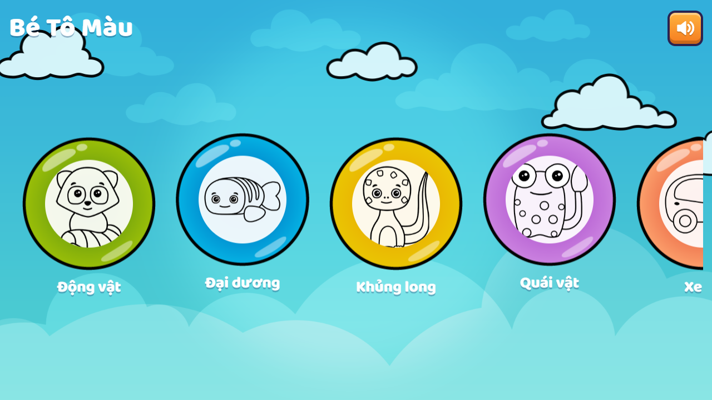
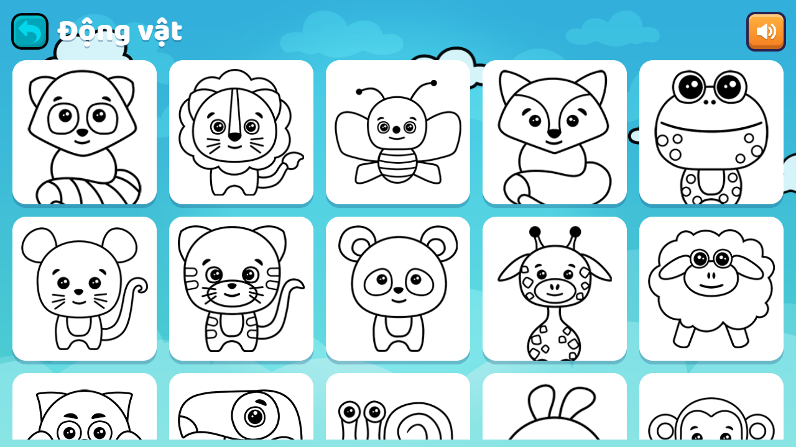
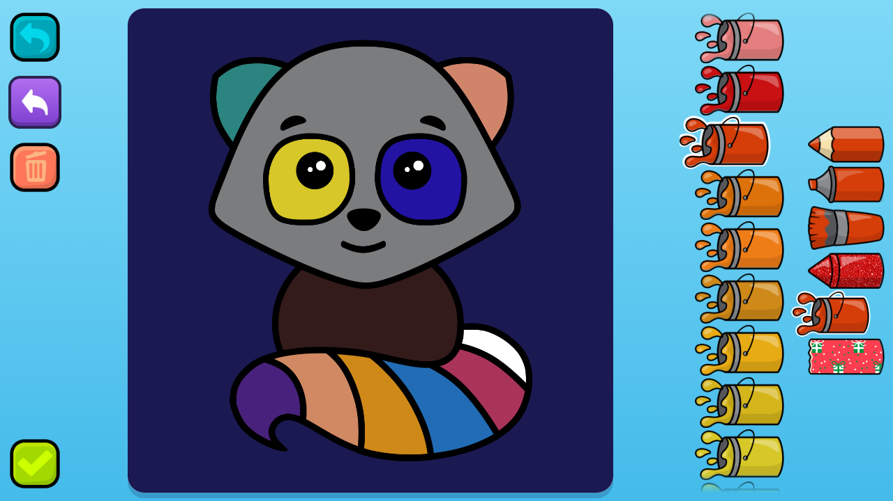

# Bé Tô Màu

Trò chơi tô màu cho bé trên trình duyệt, ưu tiên máy tính bảng và điện thoại (màn hình ngang).

**Chơi ngay:** https://shovity.github.io/kids-coloring/



## Tính năng

- 9 chủ đề, 135 bức tranh: Động vật, Đại dương, Khủng long, Quái vật, Xe cộ, Công chúa, Robot, Giáng sinh, Cổ tích.
- 6 công cụ: bút chì, bút dạ, cọ, kim tuyến, thùng sơn, hoa văn; 40 màu.
- Hoàn tác, xóa tranh, lưu tranh đã tô. Tranh được lưu trong trình duyệt (IndexedDB), không cần tài khoản.
- Có âm thanh, bật/tắt được.

| Chọn tranh | Đang tô |
| --- | --- |
|  |  |

## Chạy ở máy

```bash
npm install
npm run dev        # http://localhost:3000
npm test           # vitest
npm run typecheck
npm run build      # xuất trang tĩnh ra out/
```

## Deploy

Mỗi lần push lên `master`, workflow [`.github/workflows/deploy.yml`](.github/workflows/deploy.yml) build bản tĩnh (`output: "export"`) với `NEXT_PUBLIC_BASE_PATH=/kids-coloring` rồi deploy lên GitHub Pages.

Khi thêm đường dẫn tới file trong `public/`, dùng `asset()` / `ui()` trong `lib/manifest.ts` (hoặc `BASE`) thay vì viết `/game/...`, để còn chạy được dưới `/kids-coloring/`.
